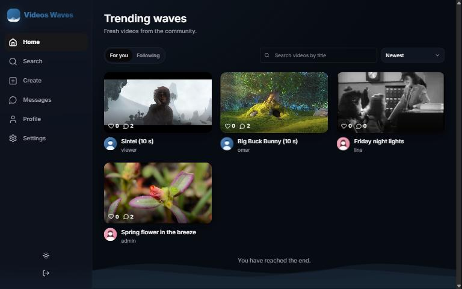
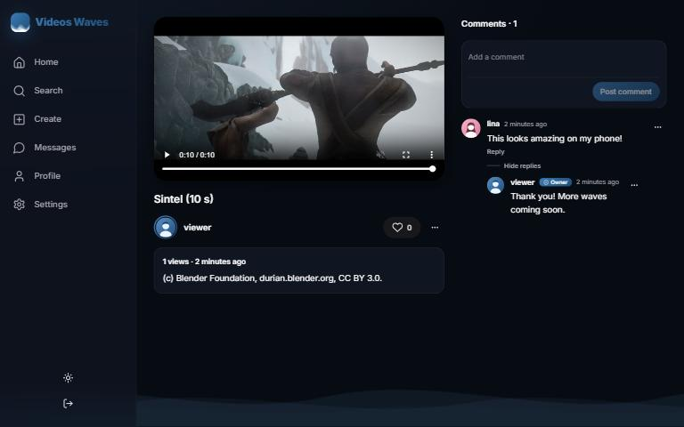
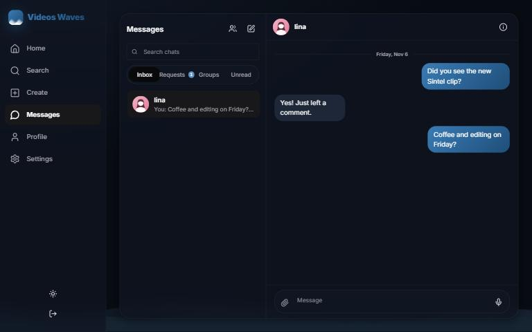
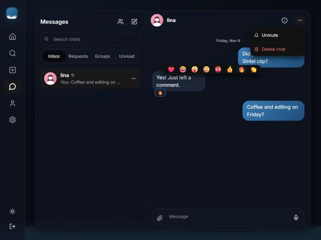
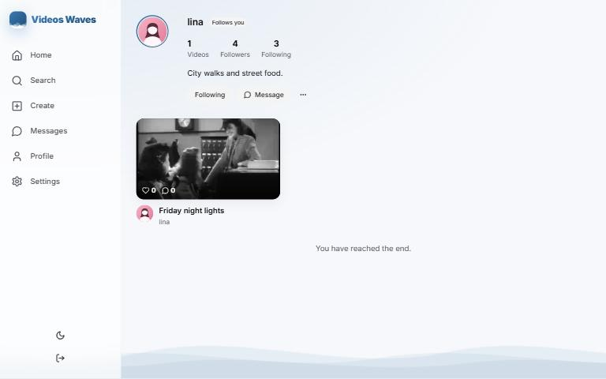
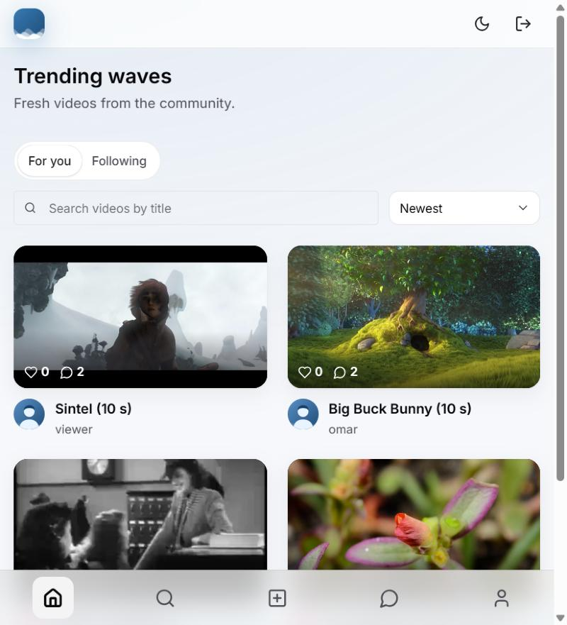

# Videos Waves — Web client

Next.js web app for Videos Waves: browse and search the video feed, upload with drag and drop, like, comment, manage your profile, and review admin requests.

**Stack:** Next.js 16 (App Router, Turbopack), React 19, TypeScript, Chakra UI 3, TanStack Query 5, Axios, React Hook Form + Zod, next-themes.

Related repositories: [server](../videos_waves_server) · [mobile app](../videos_waves_mobile) · [documentation](../videos_waves_documentation)

## Quick start

```bash
npm install
cp .env.example .env.local   # NEXT_PUBLIC_API_BASE_URL must point at the running server
npm run dev                  # http://localhost:3000
```

The server must allow this origin in its `CORS_ORIGINS`.

| Script | What it does |
| --- | --- |
| `npm run dev` | Development server |
| `npm run build` | Production build |
| `npm start` | Serves the production build |
| `npm run lint` | ESLint (Next.js core web vitals + TypeScript rules) |
| `npm run typecheck` | `tsc --noEmit` |

## Layout

```text
src/
  app/            thin App Router pages; each renders one view
  views/          page compositions (feed, video details, upload, login, register, profile, admin)
  components/
    common/       generic building blocks (see below)
    layout/       navbar
    videos/       video card, player, likes, filters, upload form, comments
    users/        auth card, profile, admin requests
    ui/           toaster, color-mode button
  hooks/          all state and data logic (react-query, forms, dialogs)
  services/       one Axios client + typed services per API resource
  middlewares/    Axios interceptors (auth refresh, error mapping) and the route guard
  providers/      Chakra, theme, react-query, auth session
  config/         env-based API URL, endpoint map mirroring the server routes, query client
  constants/      UI text, routes, query keys, limits, form field configs, enum label maps
  enums/ dtos/ interfaces/ validations/ utilities/
```

Render files only render: props interfaces, hooks, constants, and helpers are imported. No component, page, or hook file exceeds 150 lines.

## Generic components

| Component | Purpose |
| --- | --- |
| `GenericForm<T>` | Config-driven form: zod schema + field configs → inputs, validation, server field errors, submit |
| `FormDialog<T>` | `GenericForm` inside a dialog (edit profile, change password, edit video) |
| `ConfirmDialog` | Confirmation for destructive actions |
| `InfiniteGrid<T>` | Responsive grid with intersection-observer paging and a button fallback |
| `DataTable<T>` | Column-config table with responsive column hiding |
| `PaginationControls` | Previous/next pager driven by the API's page metadata |
| `QueryState` | Loading, error (with retry), empty, or content for any query |
| `StatusBadge<T>` | Any enum value with its label and color from one map |
| `FileDropzone` | Single-file drag and drop with type and size checks |
| `SearchInput`, `SelectField<T>`, `UserAvatar`, `AppLink`, `PageHeader`, `PageContainer` | Shared inputs and layout |

## Auth model

Access and refresh tokens are stored in `localStorage`. The Axios auth interceptor attaches the access token, and on a 401 it refreshes once, shared across parallel requests, and retries. A failed refresh clears the session and shows a "session expired" toast. Protected pages use the `RequireAuth` guard; the API still enforces every permission. Because the tokens are readable by page scripts, an XSS bug could expose them. The security notes in the documentation repository cover this.

## Screenshots

Captured from the production build (`npm run build && npm start`) against the in-memory API with the demo seed, signed in as `viewer`.

| Feed (dark) | Video with comments and the Owner badge |
| --- | --- |
|  |  |

| Live chat | Reactions and chat options |
| --- | --- |
|  |  |

| Profile (light) | Feed (light, tablet width) |
| --- | --- |
|  |  |
